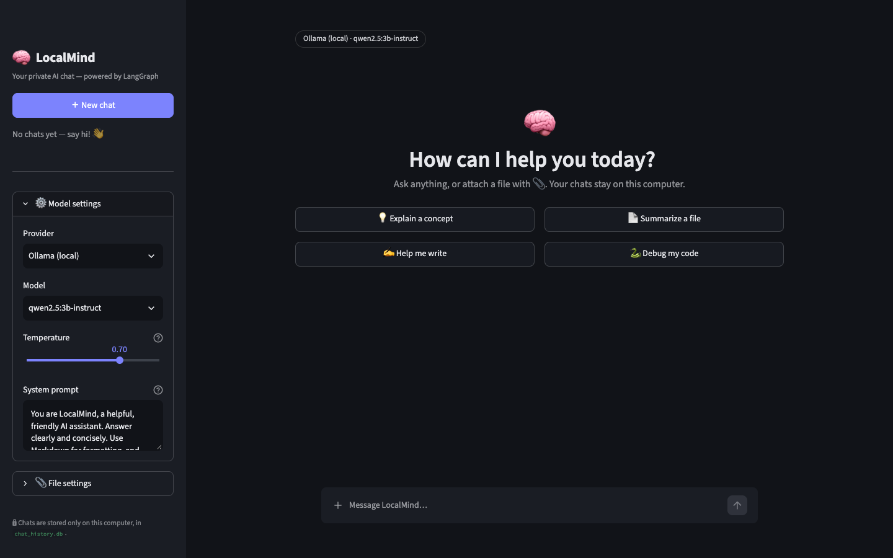

# 🧠 LocalMind

**Your private AI chat — powered by LangGraph.**

A ChatGPT-style chat app that runs on your own computer. Chat with local models through [Ollama](https://ollama.com) (fully offline) or plug in an API key for OpenAI, Anthropic, Groq, or Gemini. Your chat history is saved in a single file on your machine and never leaves it.



> This project is the capstone of my [LangChain + LangGraph study guide](https://github.com/Himanshu-joshi07/langchain-langgraph-study-guide): it combines nearly every concept from those notebooks into one real app. See [LangGraph concepts used](#-langgraph-concepts-used).

---

## ✨ Features

- 💬 **ChatGPT-style chat**: dark theme, replies stream in word by word, Markdown and code highlighting
- ⏹️ **Stop button**: stop a reply while it's being generated
- 🗂️ **Chat history**: every chat is saved; reopen any old chat from the sidebar and continue it; delete chats you don't need
- 🔌 **Switch models anytime**: Ollama (local), OpenAI, Anthropic, Groq, Google Gemini — even mid-conversation
- 🔑 **API keys from `.env`** or pasted in the sidebar for one session (never saved to disk)
- 📎 **Attach files**: PDF, Word (`.docx`), `.txt`, `.md`, `.csv` — summarize them or ask questions about them
- 🧩 **Big files are handled automatically**: they're split into chunks, summarized in parallel, and combined (map-reduce), with live progress
- ⚙️ **Adjustable limits**: presets for low-end laptops, balanced machines, or high-end/cloud setups, plus sliders for file size, pages, context window, chunk size, and parallelism
- ✍️ **Custom system prompt** to give LocalMind a personality
- ⬇️ **Export any chat** as a Markdown file

---

## 🚀 Quick start

### 1. Install Ollama (for local models)

Download it from [ollama.com](https://ollama.com), then pull a model:

```bash
ollama pull qwen2.5:3b-instruct     # small and fast (~2 GB)
# or, for better answers if your machine can handle it:
ollama pull qwen2.5:7b-instruct
```

Skip this step if you'll only use cloud providers.

### 2. Install LocalMind

```bash
git clone https://github.com/Himanshu-joshi07/localmind-ai.git
cd localmind-ai
python -m venv .venv
source .venv/bin/activate          # Windows: .venv\Scripts\activate
pip install -r requirements.txt
```

Python 3.11 or newer is required.

### 3. (Optional) Add API keys

```bash
cp .env.example .env
```

Open `.env` and fill in only the providers you use:

```env
OPENAI_API_KEY=sk-...
ANTHROPIC_API_KEY=sk-ant-...
GROQ_API_KEY=gsk_...
GOOGLE_API_KEY=AIza...
```

Restart the app after editing `.env`. You can also paste a key into the sidebar — it's kept in memory for that session only.

### 4. Run it

```bash
streamlit run app.py
```

Open **http://localhost:8501** in your browser. Run the command from inside the `localmind-ai` folder so the theme and upload settings in `.streamlit/config.toml` are picked up.

---

## 🔒 Privacy

- Chats are stored in `chat_history.db` (SQLite) **inside this folder, on your computer only**. Delete the file to erase all history.
- `chat_history.db` and `.env` are in `.gitignore`, so they're never pushed to GitHub.
- API keys are **never** written to the database.
- The app listens on `localhost` only, so other devices can't open it. (Don't change `server.address` to `0.0.0.0` unless you want people on your network to see your chats.)
- With **Ollama**, nothing leaves your machine. With a **cloud provider**, your messages are sent to that provider to generate replies — the history itself still stays local.

---

## 📎 File uploads and limits

Click **＋** in the message box to attach a file, then ask a question (or just send it to get a summary).

| File size vs. model memory | What happens |
|---|---|
| Fits in the context window | The full text is sent to the model |
| Too big | Split into chunks → each chunk summarized in parallel → summaries combined → your question answered from the combined summary |

Tune the limits in **📎 File settings** in the sidebar:

| Setting | Meaning | 🐢 Low-end | ⚖️ Balanced | 🚀 High-end / Cloud |
|---|---|---|---|---|
| Max file size | Larger files are rejected | 5 MB | 10 MB | 50 MB |
| Max pages | Longer PDFs/Word files are rejected | 20 | 50 | 300 |
| Context window | How much text the model sees at once (Ollama `num_ctx`). Higher needs more RAM/VRAM | 4,096 | 8,192 | 32,768 |
| Chunk size | Size of each piece of a big file | 1,500 | 3,000 | 8,000 |
| Parallel summaries | Chunks summarized at the same time | 1 | 2 | 5 |

Settings are remembered between sessions. The absolute upload cap is `maxUploadSize` in `.streamlit/config.toml` (default 50 MB).

**Not supported yet:** scanned PDFs (images of text need OCR).

---

## 🏗️ Project structure

```
localmind-ai/
├── app.py                # Streamlit entry point
├── config.py             # Defaults, provider model lists, presets
├── core/                 # No Streamlit imports here — reusable from notebooks or another UI
│   ├── graph.py          # Chat graph: streaming, SQLite persistence, history trimming
│   ├── summarizer.py     # Map-reduce file summarizer graph (Send API)
│   ├── providers.py      # Model factory for all providers + friendly error messages
│   ├── database.py       # Chat titles + saved settings
│   └── file_loader.py    # PDF / DOCX / TXT / MD / CSV → text, with limits
├── ui/
│   ├── sidebar.py        # History, model settings, file settings, export
│   ├── chat_view.py      # Messages, welcome screen, one chat turn
│   ├── state.py          # Session state + settings persistence
│   └── styles.css        # ChatGPT-style dark theme
├── .streamlit/config.toml
├── .env.example
└── requirements.txt
```

---

## 🧭 How it works

### The chat graph

```
START ──► chat ──► END
            │
            └─ SqliteSaver checkpointer saves the messages after every turn (per thread_id)
```

Each chat in the sidebar is one LangGraph **thread**. Sending a message calls the graph with that chat's `thread_id`; the checkpointer loads the earlier messages, the `chat` node trims them to fit the model's context, calls the model, and the reply streams to the screen token by token. The new messages are saved automatically.

### The file summarizer graph

```
START ──► split ──(small file)──► use_full_text ──────────────────► END
                └─(big file)───► summarize_chunk × N  ──► combine ──► END
                                  (parallel, one per chunk via Send)
```

---

## 📚 LangGraph concepts used

The "Learn it in" notebooks are in the [study guide repo](https://github.com/Himanshu-joshi07/langchain-langgraph-study-guide/tree/main/Langgraph).

| Concept | Where in LocalMind | Learn it in |
|---|---|---|
| `StateGraph`, nodes, edges | Chat graph and summarizer graph | `01_simple_llm.ipynb` |
| Messages state (`MessagesState`, `HumanMessage`, `AIMessage`, `SystemMessage`) | Chat history is a list of messages | `iterative_workflows.ipynb` |
| Reducers (`add_messages`, `operator.add`) | New messages append to history; chunk summaries are collected | `parallel_workflow.ipynb` |
| Persistence with a checkpointer (`SqliteSaver`) | Every chat saved to disk and resumable | `persistence.ipynb` |
| `thread_id` | One thread per chat in the sidebar | `persistence.ipynb` |
| `get_state` | Loading an old chat's messages into the UI | `persistence.ipynb` |
| Conditional edges | Small files skip summarizing; big files go to map-reduce | `conditional_workflow.ipynb` |
| Parallel fan-out / fan-in | Chunks summarized in parallel, then combined | `parallel_workflow.ipynb` |
| Prompt chaining | Summarize chunks → combine → answer the question | `prompt_chaning.ipynb` |
| **Streaming** (`stream_mode="messages"`, `"updates"`) | Token-by-token replies; live "part 3 of 6" progress | *new here* |
| **`Send` API** (dynamic parallel branches) | One branch per chunk — the count depends on the file | *new here* |
| **Runtime context** (`context_schema`) | Provider, model, and API key passed per request — and never saved to the database | *new here* |
| **`max_concurrency`** | The "Parallel summaries" setting | *new here* |
| Message trimming (`trim_messages`) | Long chats still fit small models' context | *new here* |

---

## 🛠️ Troubleshooting

| Problem | Fix |
|---|---|
| "Ollama isn't running" | Start it: `ollama serve`, or open the Ollama app |
| "Model … isn't downloaded" | `ollama pull <model-name>` |
| "No API key for …" | Add the key to `.env` and restart, or paste it in ⚙️ Model settings |
| Answers are slow or the machine struggles | Use the 🐢 Low-end preset or a smaller model |
| Small model gives wrong facts | 3B models know less; try `qwen2.5:7b-instruct` or a cloud model |
| Want to use a model that's not in the list | Pick **Custom model…** and type its name |

---

## 🗺️ Roadmap ideas

- OCR for scanned PDFs
- Image and voice input
- Edit and regenerate earlier messages
- Rename chats
- Search across chat history

## 📄 License

[MIT](LICENSE)
